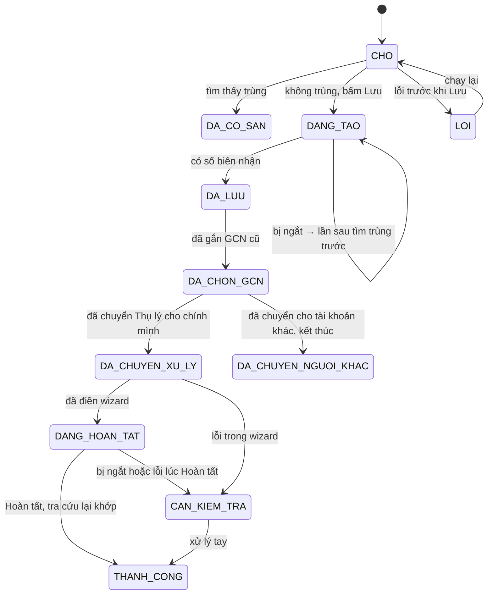

# Kiến trúc

Năm lớp, chỉ gọi từ trên xuống. Lớp Miền không biết gì về web; mọi thao tác MPLIS đi qua `MplisPort`.

```
app/     PySide6: main_window, screens/ (M1–M8), worker.py (QThread chạy Runner)
core/    runner.py (vòng lặp từng hồ sơ) · state.py (SQLite, máy trạng thái) · batch.py (nạp lô)
domain/  models.py · rules.py (BR) · gom_ho_so.py · danh_muc.py · chuan_hoa.py
mplis/   port.py (MplisPort, so_sanh) · fake.py (test) · ui_adapter.py (Playwright + Chromium)
         locators.py (đọc config/locators.toml) · pages/
infra/   excel_in.py · excel_out.py · config.py (%APPDATA%) · credentials.py (keyring) · logging.py
config/  locators.toml · danh_muc.toml       (người dùng sửa được, không cần build lại)
```

## Hợp đồng với MPLIS (`mplis/port.py`)

`cho_dang_nhap · tim_trung · mo_form · dien · chup · huy · luu · doc · ve_trang_dau · trace_start · trace_stop`

## Máy trạng thái một hồ sơ (`core/state.py`)



- Khóa hồ sơ: `Mã đầu vào|to<số tờ>|thua<số thửa>` (chế độ gộp: `Mã đầu vào|gop`).
- Chạy lại bỏ qua `THANH_CONG`, `DA_CO_SAN`, `CAN_KIEM_TRA`.
- `DANG_TAO` khi chạy lại: **bắt buộc** `tim_trung` trước; thấy thì xác nhận, không thấy mới tạo lại.
- `DA_LUU`, `DA_CHON_GCN` khi chạy lại: đi tiếp từ mốc còn dở bằng mã đã có, không tạo mới. Chạy thử bỏ qua các hồ sơ này.
- Lỗi trong wizard hoặc lúc Hoàn tất chuyển `CAN_KIEM_TRA`, không tự chạy lại vì wizard ghi dần lên máy chủ.
- Chạy thử không ghi trạng thái.

## Bộ công nghệ

| Thành phần | Chọn | Lý do |
| --- | --- | --- |
| Ngôn ngữ | Python 3.13 | |
| Môi trường | uv + uv.lock | build lặp lại được |
| Web | Playwright 1.62.0 (ghim) | locator theo vai trò/nhãn, `expect`, tracing |
| Trình duyệt | Chromium của Playwright, đóng gói kèm bộ cài | không phụ thuộc trình duyệt trên máy; profile riêng giữ phiên |
| Giao diện | PySide6 ≥ 6.8 | Playwright trong QThread |
| Excel | openpyxl | đọc ô gộp, giữ CCCD dạng chữ, ghi kết quả |
| Kiểm tra | pydantic v2 | |
| Trạng thái | SQLite (stdlib) | bền khi tắt máy giữa chừng |
| Cấu hình | TOML (`tomllib`) | sửa locator/danh mục không cần build |
| Log | loguru | 30 ngày, không ghi CCCD đầy đủ |
| Mật khẩu | keyring | Windows Credential Manager |
| Test | pytest, pytest-qt | |
| Đóng gói | PyInstaller `--onedir` + Inno Setup 6 | không cần quyền admin |
| CI | GitHub Actions (windows-latest) | tag `v*` → Release |

Dữ liệu chạy (`%APPDATA%\NhapPhieuMPLIS`): `settings.json`, `trang_thai.sqlite3`, `logs/`, `traces/`,
`screenshots/`, `chromium-profile/`, bản sửa của `danh_muc.toml` / `locators.toml`.
