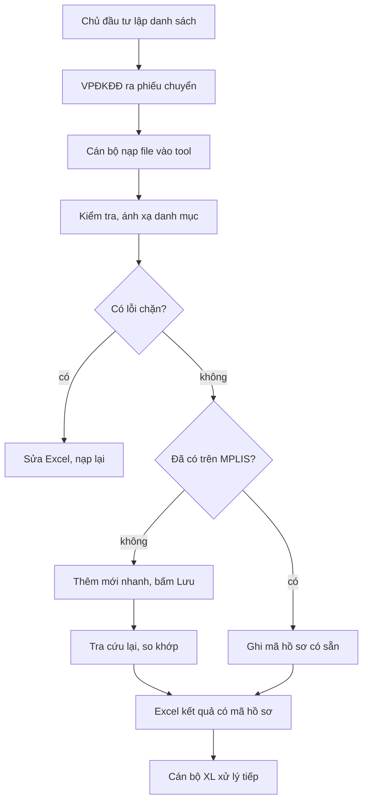

# Nghiệp vụ

Hồ sơ đi qua bốn bên: chủ đầu tư lập danh sách người mua → Văn phòng đăng ký đất đai tỉnh Hưng Yên ra
Phiếu chuyển kèm danh sách Excel → cán bộ tiếp nhận dùng tool tạo hồ sơ trên MPLIS → cán bộ xử lý
(cột *Cán bộ XL*) làm tiếp.

## Dữ liệu một dòng phiếu chuyển

Dòng tiêu đề là dòng có ô `STT` (file mẫu: dòng 5), nhóm Ông/Bà ở dòng trên. Tool tìm cột **theo tên**.

| Nhóm | Cột Excel | Bắt buộc | Ghi chú |
| --- | --- | --- | --- |
| Bên chuyển nhượng | F1, F2, F3 | — | Vd: công ty chủ đầu tư |
| Căn cứ | Xác nhận Vinhomes | — | Số phụ lục, ngày |
| Người nhận – Ông | Họ và tên, Năm sinh, CCCD, Địa chỉ | Ông hoặc Bà | CCCD dạng chữ, 12 số |
| Người nhận – Bà | Họ và tên, Năm sinh, CCCD, Địa chỉ | Ông hoặc Bà | |
| Thửa đất | Thửa đất, Số tờ, Diện tích (m2), Mã phát hành, Thời hạn sử dụng đất, Đường | Tờ, thửa | Dấu phẩy thập phân |
| Nhà ở | Loại nhà, Cấp nhà, DT xây dựng, DT sàn, Số tầng, Năm hoàn công, Kết cấu | — | "5 tầng" → 5 |
| Xử lý | Mẫu nhà, Phân loại đường, Cán bộ XL, Mã đầu vào | Mã đầu vào | |

## Quy tắc nghiệp vụ

Chuẩn chung: Excel là nguồn gốc, tool chỉ chặn khi không thể nhập (xem mục "Chuẩn chung của tool" trong `plan.md`).

| Mã | Quy tắc | Mức | Code |
| --- | --- | --- | --- |
| BR-01 | Mỗi hồ sơ có ít nhất một người nhận có họ tên | Lỗi | `domain/rules.py` |
| BR-02 | CCCD 12 số; chữ số thứ 4 khớp giới tính theo cột (Ông chẵn, Bà lẻ), số 5–6 khớp năm sinh | Cảnh báo (sai định dạng: Lỗi) | `domain/chuan_hoa.py` |
| BR-03 | Tờ, thửa nguyên dương; cặp tờ–thửa và số phát hành không lặp trong file | Lỗi | `domain/rules.py` |
| BR-04 | Không tạo nếu MPLIS đã có hồ sơ cùng tờ, thửa và người nộp là một trong những người nhận (theo CCCD); ghi lại số biên nhận có sẵn. Hồ sơ cùng thửa của người khác (lần chuyển nhượng trước) không tính là trùng | — | `core/runner.py`, `mplis/pages/tra_cuu.py` |
| BR-05 | Giá trị danh mục (loại nhà, cấp nhà, kết cấu, thời hạn, xã trong địa chỉ thửa) phải ánh xạ được sang MPLIS. Loại nhà, cấp nhà, kết cấu, thời hạn không được trống (thời hạn lấy mặc định ở Cài đặt nếu Excel trống) | Lỗi | `domain/danh_muc.py` |
| BR-06 | Thiếu Mã phát hành, Thời hạn, Mẫu nhà, Phân loại đường, Cán bộ XL | Cảnh báo | `domain/rules.py` |
| BR-07 | Chỉ ghi Thành công khi tra cứu lại thấy hồ sơ và dữ liệu khớp Excel | — | `mplis/port.py::so_sanh` |
| BR-08 | Ô tiêu đề gộp lấn xuống dữ liệu, hoặc dòng không có STT/tờ/thửa: báo, không tự đoán | Cảnh báo | `infra/excel_in.py` |
| BR-09 | Cột Người nộp (nếu có) phải là họ tên một người nhận của dòng; có cột này thì tool gõ thẳng, không tra bảng cá nhân. Một người nhận là cá nhân, hai người là vợ chồng. Chồng/vợ xác định theo chữ số thứ 4 của CCCD (chẵn Nam, lẻ Nữ), không theo cột; không có CCCD thì theo cột. Hai người cùng giới: chặn | Lỗi | `domain/rules.py` |

File mẫu (đã ẩn danh trong `tests/data/`) đang vi phạm BR-08 (ô gộp AA5:AC6, dòng 9 lạc) và BR-06.
